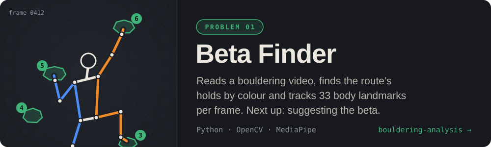
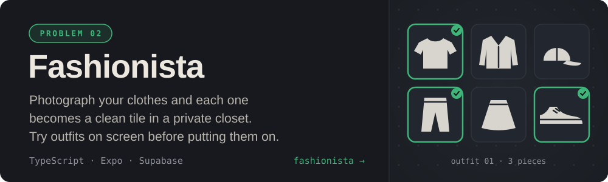

### 

Third-year Computer Science student at De La Salle University in Manila, majoring in Software Technology. **I climb**, so my main project is teaching a computer to watch a bouldering video and work out the moves. Most of what I build has to make sense of the physical world like that, from photos of clothes to faces on a webcam.

I think in diagrams first and code second. Open to **internships, student dev teams, and hackathons**.

  
  
  <!-- TODO: build the portfolio site, then point the Portfolio link at it -->
  

### 

### 

| Project | What it does | Built with |
|---|---|---|
| **[Margin](https://github.com/azorions/note-taking-app)** | A browser study notebook with stylus ink on notes and PDFs, flashcards, and Yjs sync across devices | `JavaScript` `Yjs` `Supabase` |
| **[facial-mesh-emotion-inference](https://github.com/azorions/facial-mesh-emotion-inference)** | Real-time emotion detection that keeps the webcam at 30+ FPS by running DeepFace on a background thread | `Python` `MediaPipe` `DeepFace` |
| **[Tetris](https://github.com/azorions/tetris-python)** | Tetris with SRS rotation, T-spins, three game modes, and sound and music synthesized in code instead of audio files | `Python` `pygame-ce` |

### 

`Python` `TypeScript` `JavaScript` `Java` `C` `React Native (Expo)` `Supabase` `PostgreSQL` `OpenCV`
